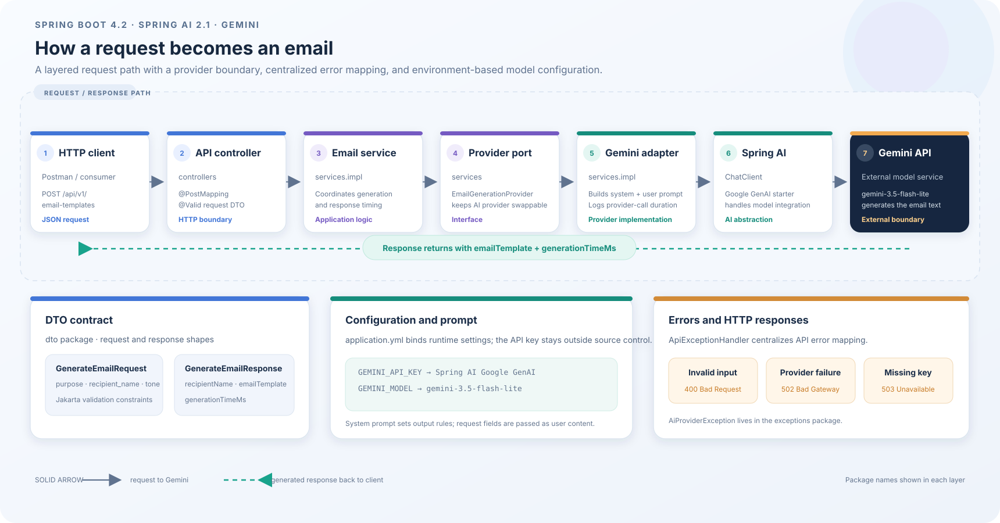
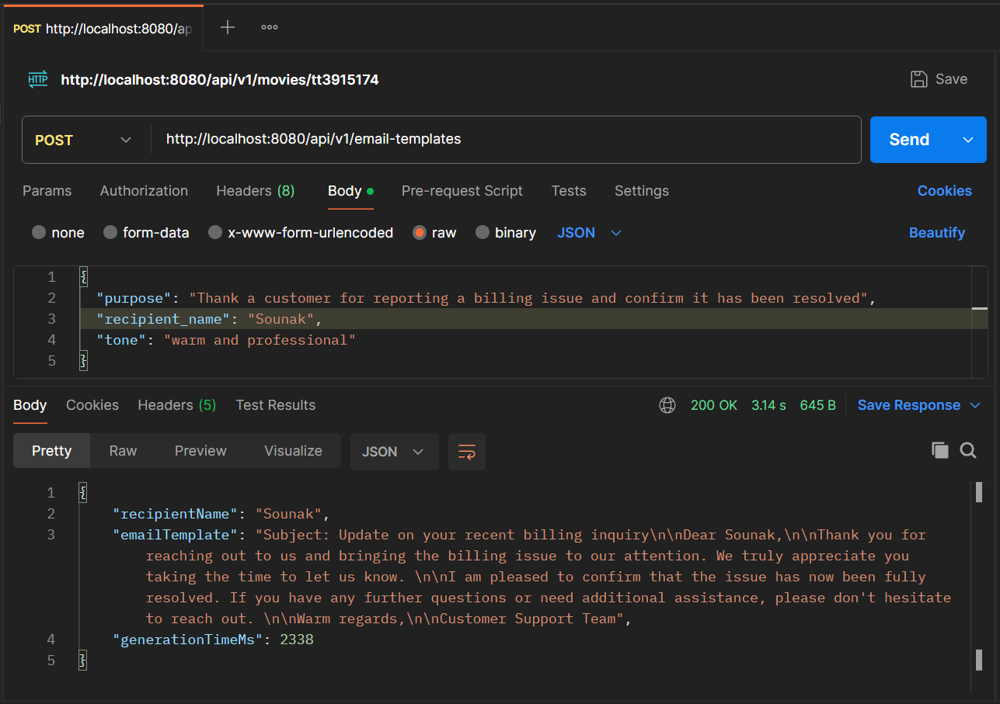

# AI-Powered Email Template Generator

A Spring Boot REST service that generates short, customer-friendly email templates from a purpose, recipient name, and tone.

## Architecture



The REST controller validates the incoming request DTO and calls the `EmailTemplateService` contract. `EmailTemplateServiceImpl` orchestrates generation through the `EmailGenerationProvider` interface; `GeminiEmailGenerationProvider` implements that contract with Spring AI's `ChatClient`. Spring AI sends the prompt to Gemini, and the generated email returns through the service and controller. `GlobalExceptionHandler`, registered with `@RestControllerAdvice`, maps validation, configuration, and provider errors into consistent HTTP error responses.

| Package | Responsibility |
| --- | --- |
| `controllers` | REST endpoints, request mapping, and HTTP boundary |
| `advices` | Global REST exception mapping with `@RestControllerAdvice` |
| `dto` | Request, response, and error payloads |
| `services` | Email service and provider contracts |
| `services.impl` | Email orchestration and Gemini provider implementation |
| `exceptions` | Application/provider exception types |

## API example

`POST http://localhost:8080/api/v1/email-templates`

Request:

```json
{
  "purpose": "Thank a customer for their feedback",
  "recipient_name": "Avery",
  "tone": "friendly"
}
```

Example response:

```json
{
  "recipientName": "Avery",
  "emailTemplate": "Subject: Thank you for your feedback\n\nHi Avery, ...",
  "generationTimeMs": 842
}
```

### Example Postman response

The screenshot below shows a successful `200 OK` response from a Postman request to the email-template endpoint.



## AI provider and prompt design

The project uses Gemini `gemini-3.5-flash-lite` through Spring AI. Gemini was selected because Google currently lists free input and output token pricing for this model on its standard free tier, making it suitable for an assignment demonstration. Free-tier availability, quotas, and model access can vary. Google may use free-tier prompts to improve its products, so avoid submitting sensitive customer information. See [Gemini model details and pricing](https://ai.google.dev/gemini-api/docs/models/gemini-3.5-flash-lite).

The system prompt asks for a concise subject and body in the requested tone, treats request fields as content, and tells the model not to invent facts. Generate or manage a Gemini API key in [Google AI Studio API keys](https://aistudio.google.com/apikey). The API key is supplied at runtime using `GEMINI_API_KEY`; credentials are intentionally not stored in this repository. See Google's [Gemini API key setup guide](https://ai.google.dev/gemini-api/docs/api-key) for key and environment variable instructions.

## Configuration reference

| Setting | Source | Purpose |
| --- | --- | --- |
| Gemini API key | `GEMINI_API_KEY` environment variable | Authenticates Spring AI with the Gemini Developer API |
| Gemini model | `GEMINI_MODEL` environment variable; default `gemini-3.5-flash-lite` | Selects the chat model |
| Server port | `SERVER_PORT` environment variable; default `8080` | Selects the HTTP listening port |
